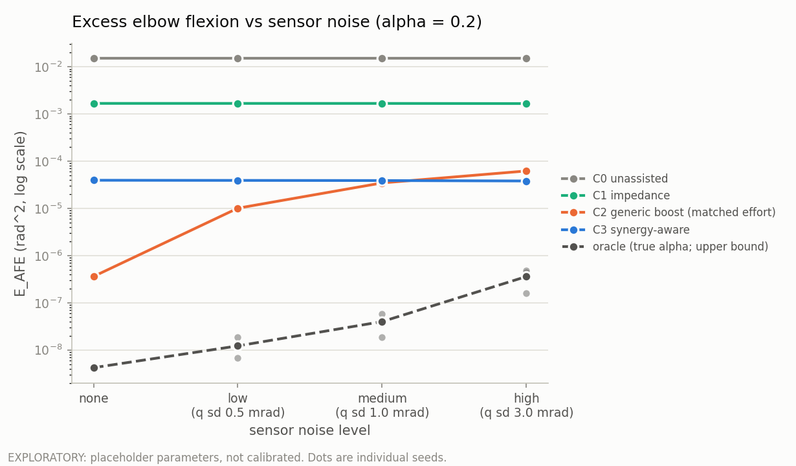

# Synergy-Aware Assist Controller

A simulation-based rehabilitation-robotics project: can a robotic assist controller detect and
compensate for **shoulder-abduction-dependent elbow-flexion coupling** during reaching, without
simply applying more assistance?

> **Status: work in progress.** The simulation, controllers, estimator and evaluation pipeline
> are implemented and tested. All numerical parameters are **uncalibrated placeholders**, so
> nothing here is a result yet. See [What is and isn't done](#what-is-and-isnt-done).

## The question

After stroke, increasing shoulder-abduction effort can drag the elbow into flexion (the abnormal
flexor synergy; Beer, Dewald & Rymer, 2000; Sukal, Ellis & Dewald, 2007). Assist-as-needed
robots typically optimise for reaching the target, not for *how* the reach is produced. A strong
enough robot can hide the coupling without addressing it.

This project builds a reduced-order simulation to ask a narrow, testable question: can an
estimator-driven controller cancel the load-dependent component of the elbow disturbance
**more efficiently than generic extra assistance at a matched effort budget**? A null result is a
valid outcome.

It is a controlled simulation only. It makes no clinical claims and does not model neural
mechanisms. The full scope and claim boundaries are in the [project charter](docs/Synergy_Aware_Assist_Controller_Project_Charter_v3.pdf)
and the [Phase 1 specification](docs/phase1_spec.md). Where they differ, the specification is
current (for example, the headline controller C3 is estimated-synergy cancellation).

## What is implemented

| Component | Module |
|---|---|
| Two-link planar arm dynamics (RK4), kinematics, Jacobian | `src/synergy_aware/arm.py` |
| Minimum-jerk reaching reference | `trajectory.py` |
| Simulated person: synergy-unaware feedforward, weak feedback, direction-specific torque limits | `human.py` |
| Abduction-dependent elbow-flexion impairment torque | `impairment.py` |
| Controllers: C0 unassisted, C1 impedance, C2 generic elbow boost, C3 synergy-aware, oracle upper bound; torque and torque-rate limits | `controllers.py` |
| Online synergy estimator (no access to ground truth, enforced by interface and test) | `estimator.py` |
| Budget-matched gain rule for C2 | `matching.py` |
| Closed-loop trial runner with seeded sensor noise and common random numbers | `simulation.py` |
| Metrics: excess elbow flexion, robot effort, dimensionless jerk, endpoint error, frozen reference | `metrics.py` |

Design choices worth knowing about:

- The impairment acts on the simulated **human** torque, not the robot's command.
- Abduction demand is a separate scalar `u_abd` in [0, 1], not an in-plane joint angle.
- The metric reference is the `alpha = 0`, noise-free, C1 elbow trajectory, shared by all
  controllers.
- The estimator subtracts the robot's own torque. Using only the residual would make the estimate
  collapse as the cancellation works (see the specification, section 6).

## Quick start

```bash
python -m venv .venv
.venv\Scripts\activate          # Windows; use `source .venv/bin/activate` elsewhere
pip install -e ".[dev]"
pytest                          # 120+ verification tests
python scripts/exploratory_comparison.py --quick
python scripts/calibrate_c3.py --quick
```

Outputs are written under `results/`.

## Exploratory output (placeholder parameters)



*Exploratory, not calibrated, three noise seeds. C2's gain is re-fitted to C3's effort at each
noise level.* In this idealised setup, matched generic assistance does better without noise and
C3 pulls ahead only under high noise, by a modest margin. C3's start-up transient dominates its
error, and a calibration run (`results/calibration/`) is still to be settled. These numbers will
change when real parameters replace the placeholders.

## What is and isn't done

Done:

- [x] Verified arm dynamics, impairment model and metrics (unit and numerical tests)
- [x] Human model, controllers, estimator, seeded noise model
- [x] Matched-budget comparator and calibration machinery with a pre-declared selection rule

Not done:

- [ ] Parameters sourced from the literature and justified (all current values are placeholders)
- [ ] C3 smoothness criterion settled and C3 calibrated
- [ ] Full experiment: several reach directions and `u_abd` levels, the residual-feedback
      ablation, model-mismatch and dynamic-`u_abd` tests, a frozen final run
- [ ] Phenomenological validation tests (workspace reduction under abduction load)
- [ ] Technical report and demonstration video
- [ ] Informal review by someone with a robotics or clinical background

## Layout

```
src/synergy_aware/   simulator, controllers, estimator, metrics
tests/               verification and consistency tests
scripts/             exploratory comparison and C3 calibration
results/             exploratory and calibration outputs (labelled as such)
docs/                charter and Phase 1 specification
notebooks/           (empty for now)
```

## References

Beer, R. F., Dewald, J. P. A., & Rymer, W. Z. (2000), *Experimental Brain Research*.
Sukal, T. M., Ellis, M. D., & Dewald, J. P. A. (2007), *Experimental Brain Research*.
Hogan, N. (1985), *Impedance control*, ASME J. Dyn. Syst. Meas. Control.
Wolbrecht, E. T., et al. (2008), *IEEE TNSRE*.
Full list in the charter. Some citation details are still to be verified.

## License

MIT. See [LICENSE](LICENSE).
